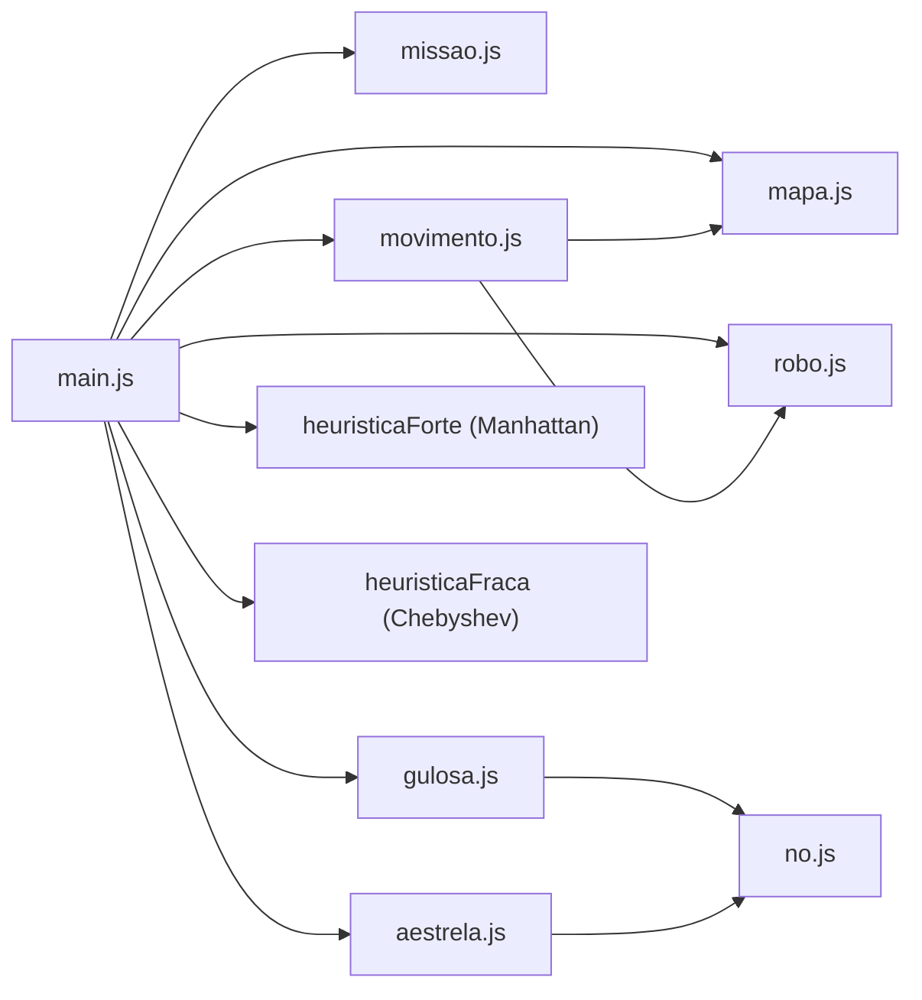
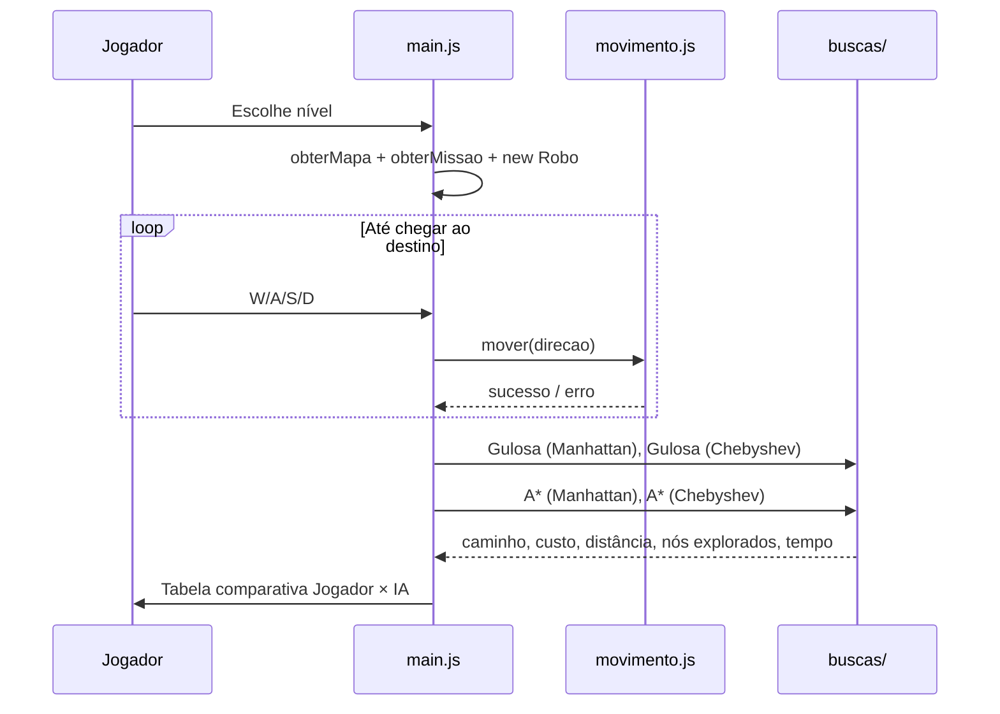

# 🏭🤖 Fábrica Inteligente — Guia completo para a apresentação

> Este documento explica **o que é o projeto**, **o que cada arquivo faz**, e principalmente **como funcionam as buscas (Gulosa e A\*) e as heurísticas (Manhattan e Chebyshev)**. A ideia é você conseguir explicar tudo com segurança.

---

## 1. O projeto em uma frase

> Um robô nasce no **centro do mapa** e precisa coletar uma peça/carga no **topo do mapa** para só então liberar a **saída (destino)**. Primeiro **o jogador** cumpre a missão manualmente com W/A/S/D; depois **a IA** resolve o mesmo desafio em duas etapas (Origem → Peça → Saída) com **Busca Gulosa** e **A\***, usando **duas heurísticas diferentes**, e o programa compara os resultados de forma justa.

O objetivo didático é mostrar:
- A diferença entre uma busca **rápida mas "míope"** (Gulosa) e uma busca **ótima** (A\*).
- O conceito de **planejamento em múltiplos estágios / sub-objetivos (waypoints)** em IA.
- Como a **qualidade da heurística** muda a quantidade de trabalho (nós explorados).

---

## 2. Visão geral da arquitetura

```
Si/
├── main.js              → "Maestro": menu, jogo no terminal, roda as buscas e compara
├── teste.js             → Testes/execuções de apoio
├── js/                  → O "mundo" do problema
│   ├── mapa.js          → Terrenos, custos e os 3 mapas
│   ├── missao.js        → Origem, destino e carga de cada nível
│   ├── robo.js          → Estado do robô controlado pelo jogador
│   ├── movimento.js     → Regras de movimento (limites, barreiras)
│   └── no.js            → Estrutura "Nó" usada pelas buscas
├── buscas/              → A inteligência
│   ├── gulosa.js        → Busca Gulosa (f = h)
│   └── aestrela.js      → Busca A*     (f = g + h)
├── heuristicas/         → As "estimativas"
│   ├── heuristicaForte.js → Distância de Manhattan
│   └── heuristicaFraca.js → Distância de Chebyshev
└── frontend/            → Versão visual (React + Vite) que reaproveita a mesma lógica em src/logic
```



**Separação importante:** a pasta `js/` modela o **problema** (o mundo), a pasta `buscas/` resolve o problema e a pasta `heuristicas/` fornece as estimativas. As buscas recebem a heurística **como parâmetro**, então dá para trocar a heurística sem mexer no algoritmo.

---

## 3. A pasta `js/` — arquivo por arquivo

### 3.1 [mapa.js](file:///home/douglas/Downloads/Si/js/mapa.js) — o terreno

**Responsabilidade:** definir *onde* o robô anda e *quanto custa* andar.

| Terreno  | Símbolo | Custo |
|----------|:------:|:-----:|
| estrada  | `.`    | 1 |
| terra    | `T`    | 3 |
| lama     | `L`    | 5 |
| barreira | `█`    | ∞ (intransponível) |

Pontos principais:
- `TERRENOS` e `CUSTOS`: tabela de tipos e seus custos.
- `class Celula`: cada quadradinho guarda `linha`, `coluna`, `tipo` e `custo`.
- `criarMapa(matrizTipos)`: transforma uma matriz de *strings* (`"estrada"`, `"lama"`...) em uma matriz de `Celula`, **validando** se o tipo existe. Retorna `{ matriz, altura, largura }`.
- **3 mapas**: Mapa 1 (10×10, fácil), Mapa 2 (20×20, mais obstáculos) e Mapa 3 (20×20, labirinto mais fechado).
- `obterMapa(nivel)`: devolve o mapa do nível.
- `imprimirMapa(mapa, missao, robo)`: desenha no terminal (R = robô, D = destino).
- `converterParaCoordenada`: converte `[linha, coluna]` em notação tipo xadrez (ex.: `A10`).

> 💡 **Ponto-chave para a apresentação:** o custo é cobrado ao **entrar** numa célula. Então o caminho "mais curto" (menos passos) **nem sempre** é o "mais barato" — pode valer a pena dar uma volta pela estrada em vez de atravessar lama.

### 3.2 [missao.js](file:///home/douglas/Downloads/Si/js/missao.js) — o objetivo

**Responsabilidade:** dizer **de onde** o robô sai, **para onde** vai e **o que** carrega.

- Nível 1: Motor, `[0,0] → [9,9]`
- Nível 2: Placa Eletrônica, `[0,0] → [19,19]`
- Nível 3: Ferramenta, `[0,0] → [19,19]`
- Funções: `obterMissoes(nivel)`, `obterMissao(nivel, id)` (com erro se não existir) e `imprimirMissao(missao)`.

Em IA, isso define o **estado inicial** e o **teste de objetivo** do problema.

### 3.3 [robo.js](file:///home/douglas/Downloads/Si/js/robo.js) — o agente do jogador

**Responsabilidade:** guardar o **estado** do robô controlado pelo humano.

- Atributos: `linha`, `coluna`, `caminho` (histórico de posições), `custoTotal`, `movimentos`.
- `mover(linha, coluna, custo)`: atualiza posição, registra no caminho, soma o custo e conta o movimento.
- `obterEstatisticas()`: retorna movimentos, custo e distância — usados na **comparação com a IA**.

> O robô **não valida nada**; ele só obedece. Quem valida é o `movimento.js`.

### 3.4 [movimento.js](file:///home/douglas/Downloads/Si/js/movimento.js) — as regras do jogo

**Responsabilidade:** decidir se um movimento é **permitido**.

- `DIRECOES`: `cima [-1,0]`, `baixo [1,0]`, `esquerda [0,-1]`, `direita [0,1]` → **só 4 direções, sem diagonal** (isso é crucial para as heurísticas!).
- `mover(direcao)`:
  1. Verifica se a direção existe;
  2. Calcula a nova posição somando o deslocamento;
  3. `posicaoValida` → está dentro do mapa?
  4. A célula é `barreira`? Se sim, bloqueia;
  5. Se estiver tudo ok, chama `robo.mover(...)` com o custo do terreno.
- `obterMovimentosPossiveis()`: lista os vizinhos transitáveis — é a **função sucessora** do problema.

### 3.5 [no.js](file:///home/douglas/Downloads/Si/js/no.js) — a peça das buscas

**Responsabilidade:** representar um **estado na árvore de busca**.

| Atributo | Significado |
|---|---|
| `linha, coluna` | posição no mapa |
| `pai` | nó de onde viemos (para refazer o caminho) |
| `custo` (**g**) | custo real acumulado desde a origem |
| `heuristica` (**h**) | estimativa do custo até o destino |
| `f` | valor de prioridade (`g + h` por padrão) |

- `obterCaminho()`: sobe pelos `pai` até a origem e monta o caminho com `unshift` (do início ao fim).

> 💡 Analogia: cada nó é um "post-it" com *onde estou*, *quanto já gastei*, *quanto acho que falta* e *de onde vim*.

---

## 4. Conceitos de busca (base teórica)

| Termo | No projeto |
|---|---|
| **Estado** | Uma posição `[linha, coluna]` |
| **Estado inicial** | `missao.origem` |
| **Ações** | cima, baixo, esquerda, direita |
| **Teste de objetivo** | posição == `missao.destino` |
| **Custo do passo** | custo do terreno de destino |
| **g(n)** | custo real da origem até *n* |
| **h(n)** | estimativa de *n* até o destino (heurística) |
| **f(n)** | o que o algoritmo usa para escolher o próximo nó |
| **Abertos (fronteira)** | nós descobertos mas ainda não expandidos |
| **Fechados (explorados)** | posições já expandidas |

**Busca informada** = usa uma heurística para "ter um palpite" de onde está o objetivo, em vez de explorar às cegas (como BFS/DFS).

---

## 5. Busca Gulosa — [gulosa.js](file:///home/douglas/Downloads/Si/buscas/gulosa.js)

### Ideia
> "Vá sempre para quem **parece** estar mais perto do destino."

**f(n) = h(n)** → ignora completamente quanto já foi gasto.

### Passo a passo do código
1. Cria `abertos` (lista), `fechados` (Set) e `nosExplorados`.
2. Cria o nó inicial com `g = 0` e `f = h(origem)`.
3. **Enquanto houver abertos:**
   - Percorre a lista e escolhe o nó com **menor `heuristica`** (linhas 75–88).
   - Remove-o da lista (`splice`).
   - Se já está em `fechados`, ignora; senão, marca como fechado e incrementa `nosExplorados`.
   - **Chegou ao destino?** → retorna `caminho`, `custo`, `distancia` e `nosExplorados`.
   - Gera os 4 vizinhos, descartando: fora do mapa, barreira, já fechados.
   - Para cada vizinho: calcula `g` (só para relatório), `h`, cria `No` com `f = h` e coloca em abertos.
4. Se a lista esvaziar → não há caminho (`custo: Infinity`).

### Características
- ✅ Geralmente **muito rápida** e explora **poucos nós**.
- ❌ **Não é ótima**: pode entrar na lama porque "está na direção certa".
- O `g` é calculado só para mostrar o custo final do caminho — **não influencia a decisão**.

> 🎤 Frase para a apresentação: *"A gulosa é como alguém que anda sempre na direção do destino sem olhar o chão — chega rápido, mas pode atravessar um lamaçal."*

---

## 6. Busca A\* — [aestrela.js](file:///home/douglas/Downloads/Si/buscas/aestrela.js)

### Ideia
> "Escolha quem tem o melhor **custo total estimado**: o que já gastei + o que acho que falta."

**f(n) = g(n) + h(n)**

### Passo a passo do código
1. Estruturas:
   - `abertos`: fronteira;
   - `fechados`: posições já expandidas;
   - `melhoresCustos` (Map `"linha,coluna" → g`): **o menor custo conhecido** para chegar a cada posição. Esse é o grande diferencial em relação à Gulosa.
2. Nó inicial: `g = 0`, `h = h(origem)`, registra `melhoresCustos["0,0"] = 0`.
3. **Enquanto houver abertos:**
   - **Escolhe o menor `f`** (linhas 61–88). **Desempate:** se `f` empatar, prefere o menor `h` (o que está mais perto do destino) → reduz nós explorados.
   - Remove da lista.
   - **Descarta caminhos piores** (linhas 103–114): se o `g` deste nó é maior que o melhor conhecido, ele é uma cópia "velha" e é ignorado (técnica de *lazy deletion*: em vez de atualizar o nó na lista, coloca-se um novo e o antigo é ignorado depois).
   - Se já está fechado, ignora; senão fecha e conta.
   - **Chegou ao destino?** → retorna o resultado.
   - Para cada vizinho válido (dentro do mapa, não barreira):
     - `novoCusto = g(atual) + custo do terreno`;
     - Se já existe um caminho **igual ou melhor** para ele → ignora;
     - Senão, registra o novo melhor custo, calcula `h`, cria o nó com `f = g + h` e adiciona em abertos.
4. Sem abertos → sem caminho.

### Características
- ✅ **Ótima** (encontra o caminho de **menor custo**) desde que a heurística seja **admissível**.
- ✅ **Completa** (se houver caminho, encontra).
- ❌ Costuma explorar **mais nós** que a Gulosa.

> 🎤 Frase: *"O A\* é o motorista com GPS: ele considera o quanto já rodou e o quanto falta, e por isso encontra a rota mais barata."*

### Gulosa × A\* lado a lado

| | Gulosa | A\* |
|---|---|---|
| Critério | `f = h` | `f = g + h` |
| Considera custo já gasto? | ❌ | ✅ |
| Guarda melhor custo por célula? | ❌ | ✅ (`melhoresCustos`) |
| Garante menor custo? | ❌ | ✅ (com h admissível) |
| Nós explorados | Poucos | Mais |
| Velocidade | Muito rápida | Um pouco mais lenta |

---

## 7. Heurísticas

### O que é uma heurística?
Uma **função que estima** quanto falta para chegar ao objetivo, sem precisar resolver o problema. Ela recebe `posicaoAtual` e `objetivo` e devolve um número.

### Conceito essencial: **admissibilidade**
Uma heurística é **admissível** se **nunca superestima** o custo real. É isso que garante que o A\* encontre o caminho ótimo.

Neste projeto o **menor custo de um passo é 1** (estrada) e o robô anda **só em 4 direções**. Logo, o custo real é sempre ≥ número mínimo de passos. Por isso as duas heurísticas abaixo são admissíveis.

### 7.1 Heurística Forte — Manhattan — [heuristicaForte.js](file:///home/douglas/Downloads/Si/heuristicas/heuristicaForte.js)

```
h = |linha1 − linha2| + |coluna1 − coluna2|
```

- É **exatamente** o número mínimo de passos num mapa **sem diagonais** e sem obstáculos.
- **Por que "forte"?** Porque é a estimativa mais próxima do real sem passar dele → é **mais informada**.

### 7.2 Heurística Fraca — Chebyshev — [heuristicaFraca.js](file:///home/douglas/Downloads/Si/heuristicas/heuristicaFraca.js)

```
h = max(|linha1 − linha2|, |coluna1 − coluna2|)
```

- Seria o número de passos **se o robô pudesse andar na diagonal** (como o rei no xadrez).
- Como o robô **não** anda na diagonal, ela **subestima mais** o custo.
- **Por que "fraca"?** Continua admissível, mas é menos precisa → o algoritmo tem menos "pista" e explora mais.

### Exemplo numérico
Robô em `[0,0]`, destino em `[9,9]`:

| Heurística | Cálculo | h |
|---|---|---|
| Manhattan | 9 + 9 | **18** |
| Chebyshev | max(9, 9) | **9** |
| Custo real mínimo (só estrada) | — | ≥ 18 |

Sempre vale: **Chebyshev ≤ Manhattan ≤ custo real**. Diz-se que Manhattan **domina** Chebyshev.

### Impacto nos algoritmos
- **No A\***: as duas encontram o **mesmo custo ótimo**, mas com **Manhattan o A\* explora menos nós** (a heurística "puxa" melhor para o destino). Com Chebyshev, o `h` é pequeno demais e o A\* se comporta mais como uma busca de custo uniforme (Dijkstra), espalhando-se mais.
- **Na Gulosa**: como ela só olha `h`, trocar a heurística muda a **ordem de exploração** e pode mudar o caminho encontrado e o custo final. Com Chebyshev ocorrem muitos **empates** (várias células têm o mesmo `max`), o que deixa a gulosa mais "perdida".

---

## 8. Fluxo do programa — [main.js](file:///home/douglas/Downloads/Si/main.js)



- `converterTecla`: W/A/S/D → cima/esquerda/baixo/direita.
- `jogarNivel`: loop do jogo do humano.
- `executarBuscas`: roda as **4 combinações** (2 algoritmos × 2 heurísticas) medindo o tempo.
- `mostrarResultadoBusca` / `mostrarResultadoJogador`: exibem as métricas.

### Métricas comparadas
- **Distância**: número de passos.
- **Custo**: soma dos custos dos terrenos (é o que realmente importa).
- **Nós explorados**: quanto "trabalho" o algoritmo fez.
- **Tempo (ms)**.

---

## 8.1 Modo de Visualização da IA (Exploração Passo a Passo e Logs Matemáticos)

A interface gráfica (Frontend) conta com um **modo de visualização profunda da IA**, onde é possível assistir ao algoritmo tomando decisões em tempo real:

* **Cores no Mapa durante a Animação:**
  * 🟡 **Amarelo (Fronteira / Abertos):** células que foram identificadas e estão aguardando expansão na lista de prioridade.
  * 🔴 **Vermelho (Explorados / Fechados):** células que o algoritmo já retirou da fila e expandiu.
  * 🔵 **Azul (Rota Final):** o caminho ótimo completo após alcançar a meta.
  * 🟢 **Verde:** o destino da etapa atual (primeiro a Peça no topo à esquerda, depois a Saída).
  * **Ciano Pulsante:** o nó exato que está sendo avaliado naquele milissegundo.

* **Tabela de Logs e Contas em Tempo Real (à direita do mapa):**
  * **Cálculo Matemático Explicado:**
    * Para **A\***: exibe a equação $f(n) = g(n) + h(n)$, mostrando explicitamente o custo acumulado $g$, a heurística estimada $h$ e o total $f$.
    * Para **Gulosa**: exibe $f(n) = h(n)$, destacando em vermelho que o custo real percorrido $g$ é completamente ignorado.
  * **Análise dos 4 Vizinhos:** tabela com os blocos ao redor (Cima, Baixo, Esquerda, Direita) contendo suas coordenadas, terrenos, cálculos e a decisão tomada (ex: *"Adicionado à fronteira"*, *"Bloqueado: Barreira"*, *"Caminho já conhecido é melhor"*).
  * **Controles de Playback:** botões de Play/Pause, avançar/retroceder passo a passo, slider de progresso e ajuste de velocidade (0.5x, 1x, 2.5x).

---

## 9. Resultados esperados (o que defender)

1. **A\* (Manhattan)** → custo **ótimo** com **menos nós** que o A\* (Chebyshev). *Melhor combinação.*
2. **A\* (Chebyshev)** → **mesmo custo ótimo**, porém **mais nós explorados**.
3. **Gulosa** → pouquíssimos nós e muito rápida, mas o custo pode ser **maior** que o ótimo (atravessa terra/lama).
4. **Jogador** → normalmente igual ou pior que o A\*; o A\* serve de **"gabarito"** do menor custo.

---

## 10. Perguntas que o professor pode fazer

- **Por que o A\* é ótimo?** Porque usa `g + h` e as heurísticas são admissíveis (nunca superestimam, já que o custo mínimo por passo é 1 e não há diagonal).
- **Por que a Gulosa não é ótima?** Porque ignora `g`; ela só olha o quanto falta e não o quanto já gastou.
- **Para que serve o `melhoresCustos`?** Para não reexplorar uma célula por um caminho mais caro e permitir que um caminho mais barato descoberto depois substitua o anterior.
- **Para que serve o `fechados`?** Evitar expandir a mesma posição duas vezes (evitar laços).
- **Para que serve o `pai` no Nó?** Reconstruir o caminho final no `obterCaminho()`.
- **Por que desempatar pelo menor `h`?** Entre dois nós de mesmo `f`, o mais próximo do destino tende a chegar antes → menos nós explorados.
- **Chebyshev é admissível aqui?** Sim, ela é ≤ Manhattan, que é ≤ custo real. Só é **menos informada**.
- **E se tivesse movimento diagonal?** Manhattan poderia **superestimar** (deixaria de ser admissível) e Chebyshev passaria a ser a heurística adequada.
- **Possível melhoria?** Trocar a lista `abertos` (busca linear O(n) pelo menor `f`) por uma **fila de prioridade / heap** (O(log n)).

---

## 11. Resumo de 30 segundos

> "Modelamos uma fábrica como uma grade com terrenos de custos diferentes. O jogador tenta levar a carga até o destino e depois a IA resolve o mesmo problema com Busca Gulosa (f = h), que é rápida mas não garante o menor custo, e A\* (f = g + h), que garante o caminho mais barato. Testamos duas heurísticas admissíveis: Manhattan, que é a mais informada para movimento em 4 direções, e Chebyshev, mais fraca. O resultado mostra que heurísticas melhores fazem o A\* explorar menos nós sem perder a otimalidade."
